# Learn Deep Learning Fault Identification in Half a Day! From Beginner to Publication! CNN, BiLSTM, GRU, LSTM, TCN, CNN-LSTM, CNN-GRU

Applicable Platform: Matlab 2023 and above
Method: You are likely familiar with such literature that features models like CNN, LSTM, GRU, BiLSTM, GRU, Attention, and their composite models like CNN-LSTM, CNN-GRU. These models have stood the test of time.
Function: Classification prediction is used to categorize input data into different categories or labels. The output is discrete, typically representing a category or label. For example, in areas such as rolling bearing faults, transformer oil gas faults, power system transmission line fault areas, insulators, distribution networks, and disturbances in electric power quality, recognition, diagnosis, and classification can be performed.
Journal Level: Carefully review the following literature, all from top domestic EI journals such as "China Electric Power Journal", "Grid Technology", "High Voltage Technology", "Electrical Engineering Technology", "Power System Automation".
Publication Date: From 2022-2024 to date, various deep learning methods combined to form composite fault identification models, which is the mainstream of current publications. You can also do it!
Composite Model: Taking the CNN-BiLSTM-Attention composite model as an example, it combines Convolutional Neural Network (CNN) and Long Short-Term Memory Network (LSTM), overcoming the limitations of each model in processing sequence data. Here are some advantages of the CNN-LSTM composite model:
Local and global feature capture: CNN can effectively capture local features in the fault waveform through convolutional layers, such as pulses, vibrations, or other sudden changes. Meanwhile, LSTM can learn long-term dependencies in the sequence, capturing global features. This combination allows the model to focus on both local and global information in the sequence, enhancing the ability to extract complex features from the fault waveform.
Feature Construction Before and After Fault: For spatiotemporal relationships in sequential data, the CNN-BiLSTM model can utilize CNN for convolution operations on time series to capture temporally adjacent features. It also processes long-term dependencies in sequences through the BiLSTM bidirectional memory units to capture the long-term dependencies of signals, while considering the features contained before and after the fault.
Hierarchical Feature Extraction: CNNs usually extract low-level features at the bottom layer, while BiLSTMs extract abstract features at a higher level. By combining them, the model can perform hierarchical feature extraction at different levels, enabling it to understand the fault waveform more comprehensively.
Attention Self-Attention Mechanism: The self-attention layer is embedded into the BiLSTM layer, which is used to capture global dependencies in the fault waveform. The self-attention mechanism allows the network to dynamically adjust the weights of each sampling point during learning, so as to better capture long-term dependencies and global patterns.
Firstly, briefly introduce the characteristics of existing prediction algorithms! Then, combine them in a modular way according to your needs: CNN-LSTM, CNN-GRU, CNN-BiLSTM, CNN-BiGRU, CNN-LSTM-Attention, CNN-GRU-Attention, CNN-BiLSTM-Attention, CNN-BiGRU-Attention, TCN-Attention, you can also publish high-level papers!
CNN (Convolutional Neural Network): CNN is applicable to image data, but it is also suitable for one-dimensional fault waveform data. Convolutional layers can capture local sudden feature changes in the input fault waveform. For fault recognition tasks, CNN can effectively capture local features in the input fault waveform, such as pulses, vibrations, or other sudden changes. It helps identify changes within a specific time window and is suitable for one-dimensional time-series data. Here are the classification principles of CNN:
1. Firstly, CNN continuously scans the original input with convolutional kernels to extract features from the input image;
2. Through the stacking of multiple CNN layers, fine-grained (advanced) features can be continuously achieved.
3. The most advanced features extracted by CNN are compared with the given fault labels through Softmax to find the label with the highest probability, which is the fault identification result.
LSTM (Long Short-Term Memory Network): LSTM is specifically designed for processing sequence data. Its internal structure allows the network to selectively retain or forget information, which helps to handle long-term dependencies in time series data. In fault identification, LSTM can better capture the feature correlation between the fault and its surroundings, suitable for fault waveforms and other features with dynamic changes.
GRU (Gated Recurrent Unit): GRU is similar to LSTM but has a simpler structure. It also applies to fault waveform data, with update and reset gates to regulate the flow of information. Compared to LSTM, GRU has higher computational efficiency, performing better on medium-sized datasets.
BiGRU (Bidirectional Gated Recurrent Unit Network): BiGRU combines forward and backward GRU, considering both past and future context information. In fault identification, BiGRU can more comprehensively capture patterns in fault waveforms, especially when considering the characteristics before and after the fault.
TCN (Temporal Convolutional Network): TCN innovatively proposes one-dimensional expansion causal convolution layers to construct residual structures to capture features in fault waveforms, and stacks these layers to increase the complexity of the model. It has the advantage of parallel computing. Advantages: In fault identification, TCN can effectively capture local and global features in fault waveforms, has a faster training speed, and is suitable for application.
The innovation of various compound models lies in:
Integrating different types of neural network layers to make them applicable to a wide range of applications, thereby enhancing the modeling and analysis capability of fault sequence data.
The product is suitable for various data classification scenarios, such as rolling bearing faults, transformer oil gas faults, power system transmission line fault areas, insulators, distribution networks, and disturbances to power quality. It is used for identification, diagnosis, and classification of these issues.

The program dataset format:
- Data format: Each row represents a fault sample, which can also be seen as a fault waveform. The last column indicates the fault category of that sample, i.e., the fault label.

- Test set confusion matrix:
- Precision is the bottom row of the confusion matrix, while recall is the rightmost column.

- Precision: Refers to the proportion of samples predicted as positive categories by the model that are actually positive. It measures the accuracy of the model in predicting positive categories.

- Recall: Refers to the proportion of actual positive samples that the model successfully predicts as positive. It measures the model's ability to cover positive samples.

- Training set and test set scatter plots:
- Program displays results such as accuracy, precision, recall, F1 score, etc.

Stay tuned for high-quality innovative learning materials and articles with code updates from time to time!

## Images

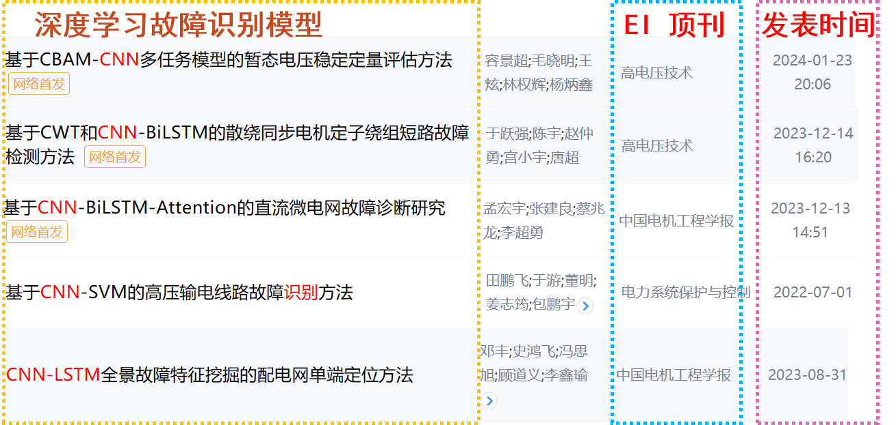
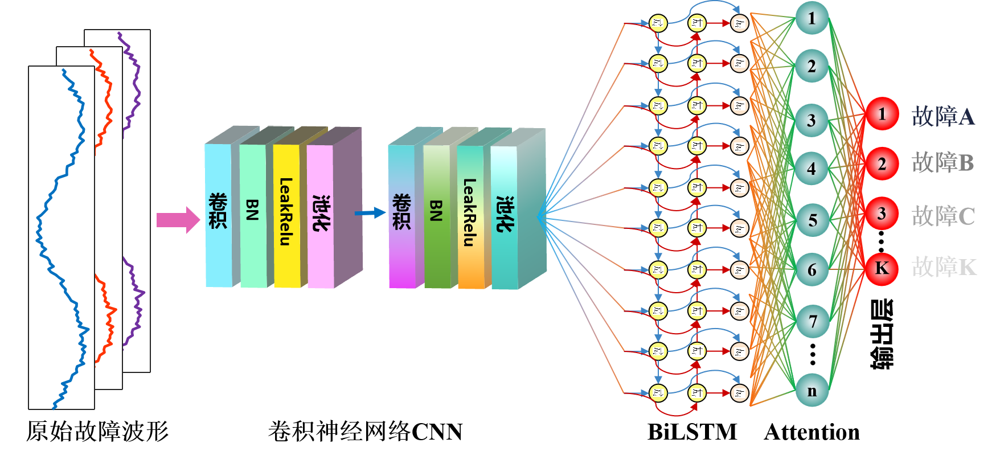
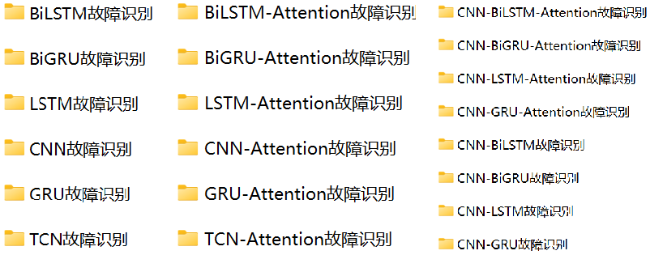
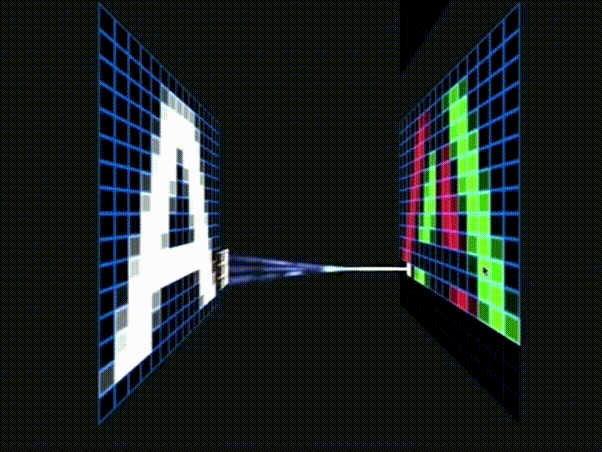

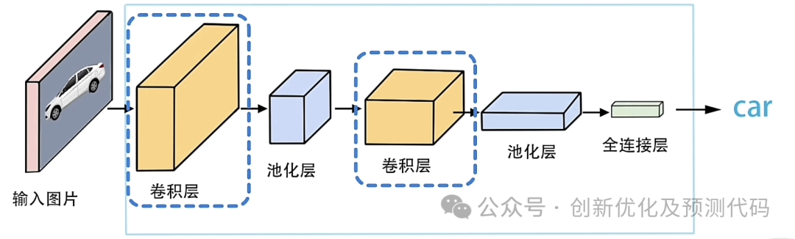
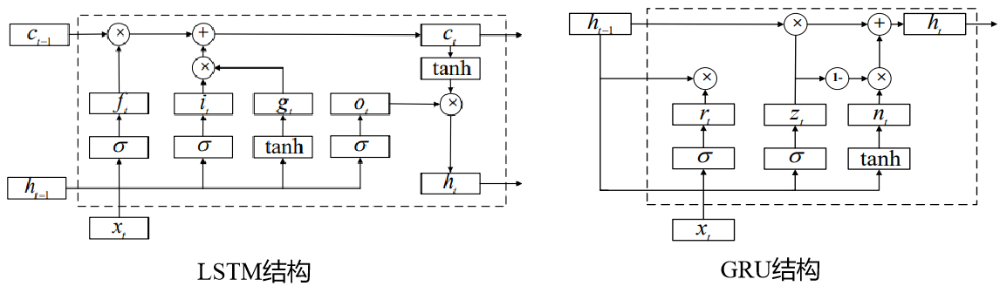
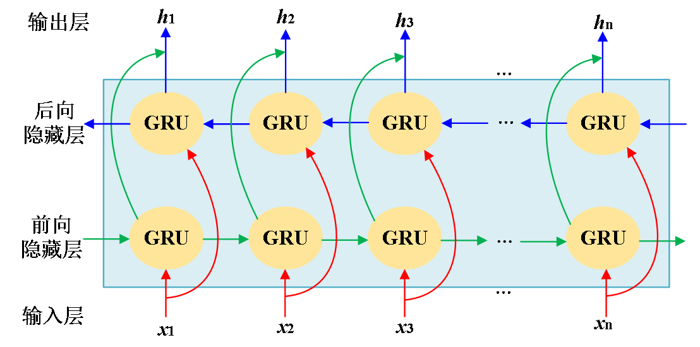
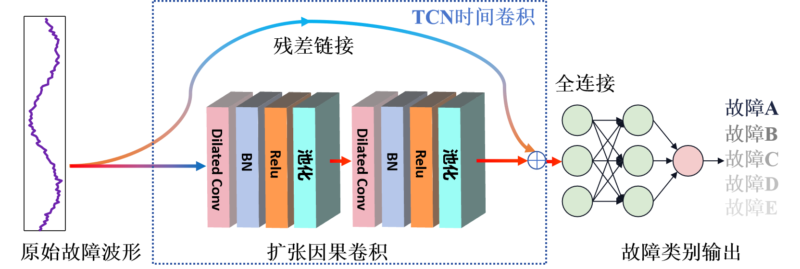

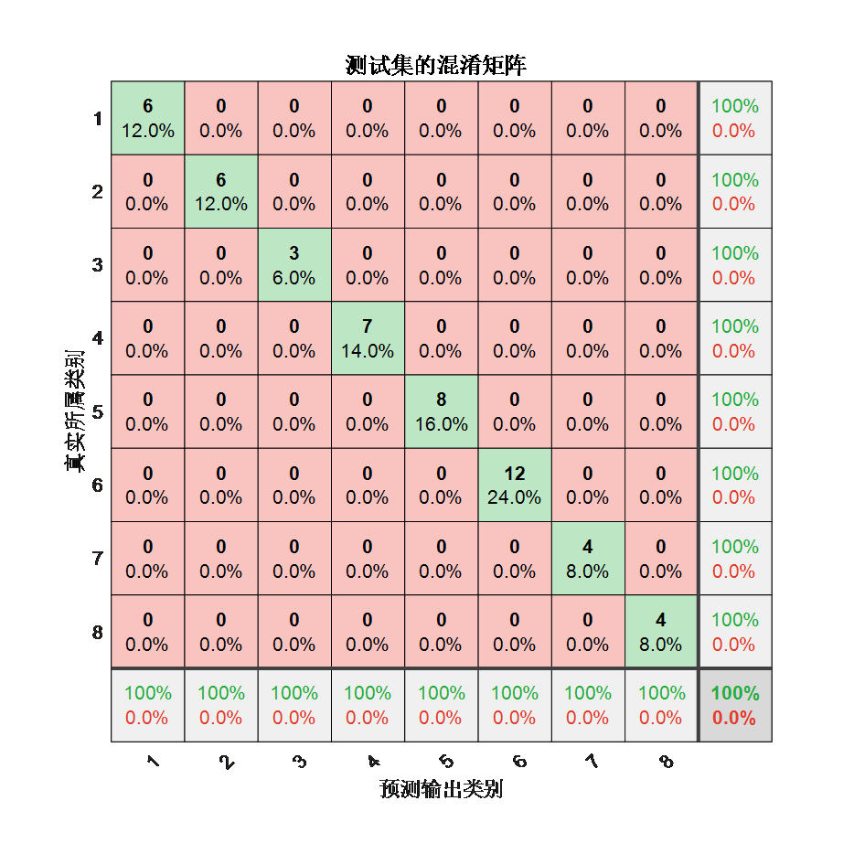
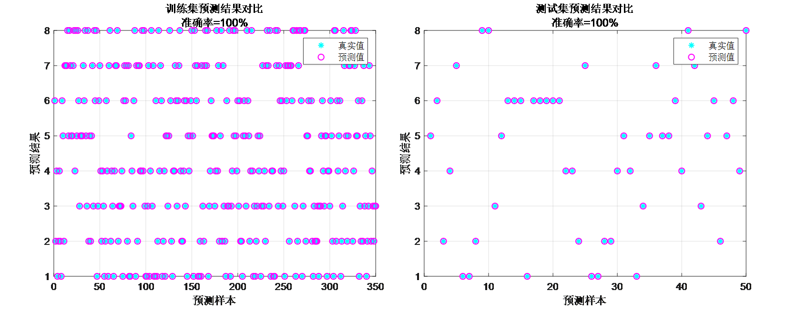
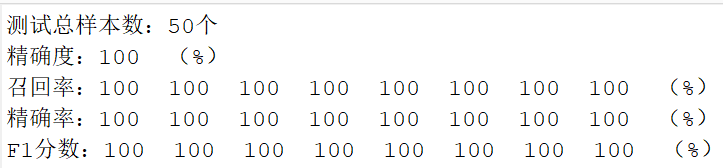

<!-- PAYMENT_BLOCK -->

## Get this dataset

- Payment link (Stripe): [Buy now](https://buy.stripe.com/3cs8yP7sY87d0vu9AB)
- Payment QR code: 

<!-- /PAYMENT_BLOCK -->
